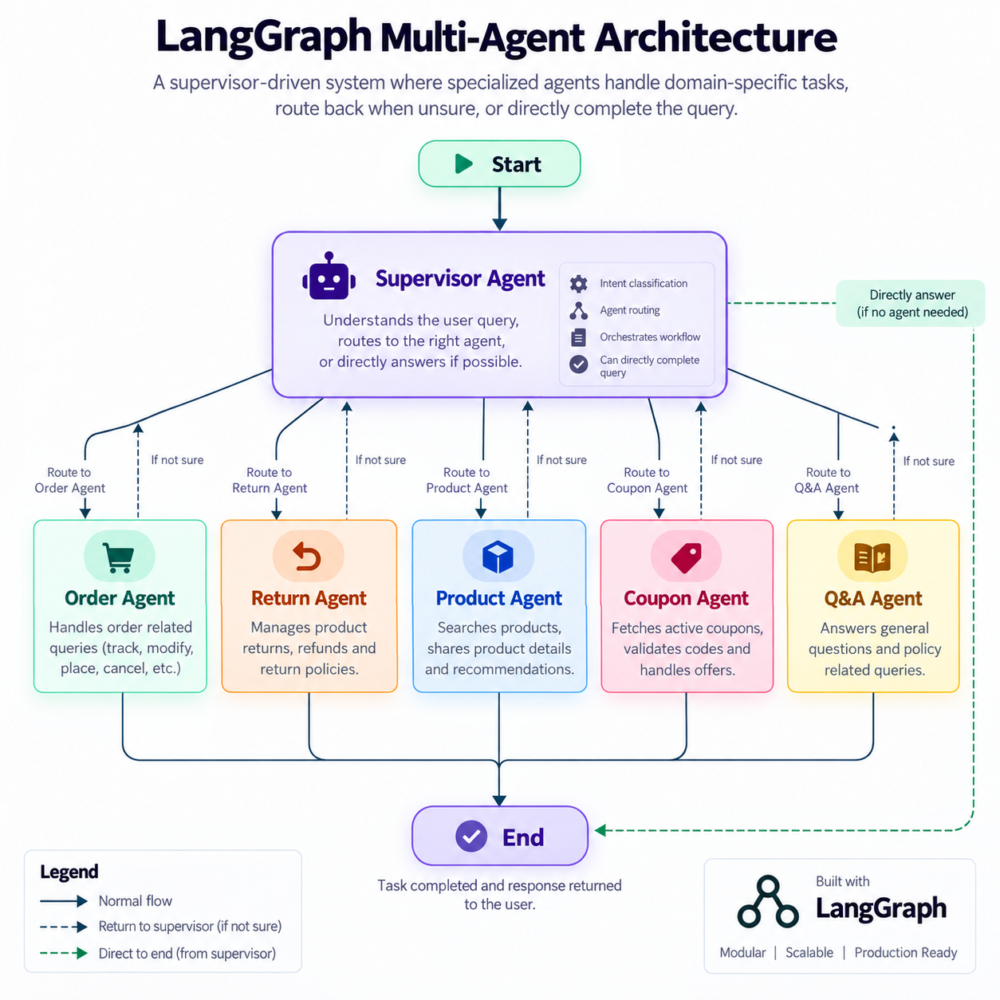
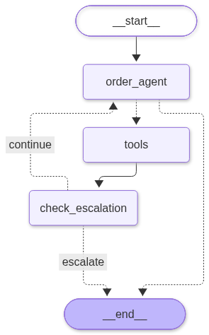
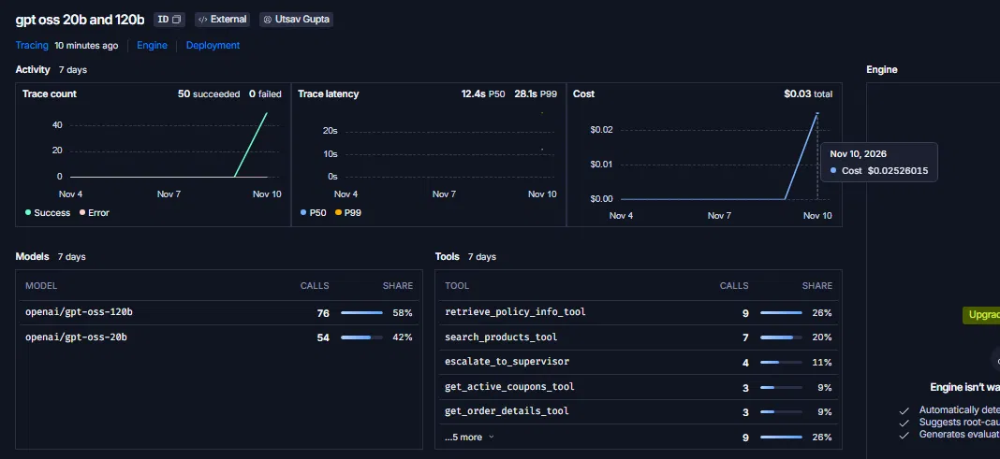
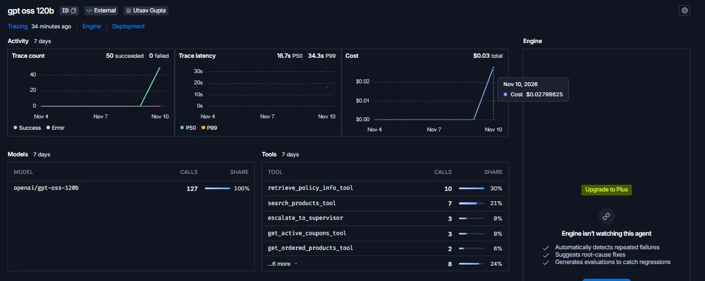
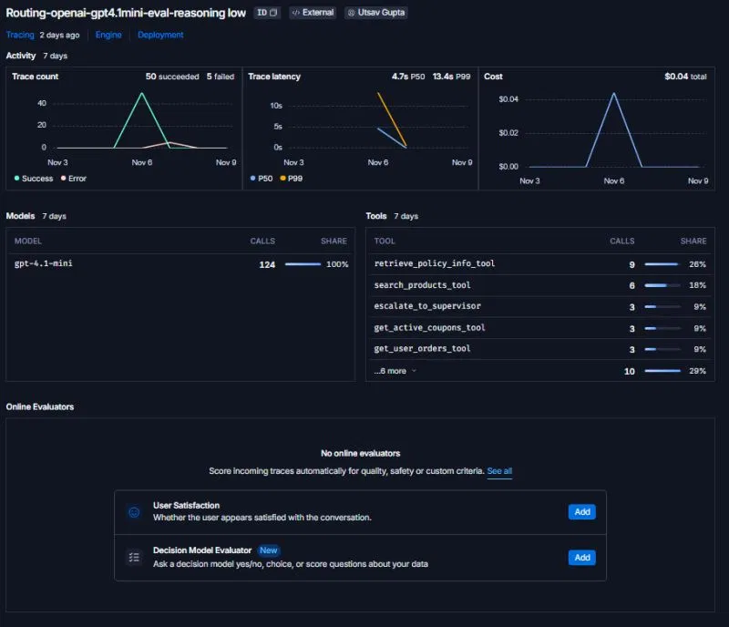

# BrightCart Support AI: Multi-Agent Customer Service with RAG

> A LangGraph-based multi-agent AI customer support system with controlled database access and grounded RAG for BrightCart.

## Quick Navigation (Recruiter / Reviewer Index)

- [⚡ Evaluation & Model Selection (Recruiter Highlights)](#evaluation--model-selection-recruiter-highlights)
- [🛠️ Engineering Highlights](#engineering-highlights)
- [✨ Key Features](#features)
- [🏗️ Multi-Agent Architecture & Flow](#architecture)
- [📊 Deep-Dive LLM Benchmarking & Evaluation](#llm-benchmarking-and-model-selection)
- [🏢 Enterprise Architecture Comparison (Amazon Rufus vs. BrightCart)](#enterprise-architecture-comparison-amazon-rufus-vs-brightcart)
- [🚀 Future Scope & Product Roadmap](#future-scope--product-roadmap)
- [💻 Tech Stack & Infrastructure](#tech-stack)
- [📁 Project Structure](#project-structure)
- [⚙️ Setup & Installation](#setup--installation)
- [🗄️ Database Schema](#database-schema)
- [📜 License](#license)

## Overview

This is a LangGraph-based multi-agent AI customer support system where a supervisor routes queries to agents for orders, returns, products, coupons, and policy retrieval. Each agent can access the company database only through a fixed set of validated SQLAlchemy tools, never through raw SQL generated by the LLM. This controlled boundary eliminates SQL injection and prompt-injection-driven unscoped data access as an attack surface.

## Evaluation & Model Selection (Recruiter Highlights)

- **Shipped Production Model:** **OpenAI GPT-4.1 Mini** (achieved the fastest median turn-around at **p50: 4.76s**).
- **Core Benchmark Results (50 Standardized Multi-Agent Turns):**
  - **OpenAI GPT-4.1 Mini:** Cost **$0.0442** | Median Latency (**p50: 4.76s**) | p99: 27.61s
  - **OpenAI GPT-4o Mini:** Cost **$0.0206** | Median Latency (**p50: 6.41s**) | p99: 16.21s
  - **Groq OSS 20B + 120B Split:** Cost **$0.0253** | Median Latency (**p50: 12.38s**) | p99: 29.73s *(tested on Free Tier)*
  - **Groq OSS 120B Alone:** Cost **$0.0280** | Median Latency (**p50: 17.43s**) | p99: 37.23s *(tested on Free Tier)*

> [!IMPORTANT]
> **Key Architecture Finding & Recommended Target Deployment:**  
> While Groq open-source models experienced queue-latency overhead on the free tier, our profiling shows the **ideal high-scale production setup is a hybrid Groq deployment: `openai/gpt-oss-20b` (Supervisor) + `openai/gpt-oss-120b` (Specialists)**.
> - **Measured Cost & Latency Reduction:** Decoupling the supervisor to 20B already delivered an **8.64% cost reduction** and cut p50 latency from 17.43s to 12.38s (**~29% faster**) compared to 120B alone—even with reasoning uniformly set to medium.
> - **Tiered Reasoning:** Configured with **low/none reasoning** on deterministic nodes (Supervisor, Product, Coupon, QA) and **medium reasoning** strictly on stateful mutation nodes (Order and Return agents). This is estimated to further substantially reduce completion token overhead.
> - **Throughput Advantage:** Under paid Groq LPU plans, 20B delivers **~1,000 TPS** (sub-100ms routing) and 120B delivers **~500 TPS**, achieving an estimated end-to-end multi-agent latency of **<3.5 seconds**.

👉 **[📊 Jump to Complete Multi-Model Evaluation Table & Breakdown below ↓](#llm-benchmarking-and-model-selection)**

## Engineering Highlights

- **Injection-Safe, Scoped Database Access:** LLM agents interact with PostgreSQL strictly through typed SQLAlchemy tools with pre-validated parameters—eliminating raw SQL generation and prompt-injection-driven unscoped data access.
- **True Multi-Agent Orchestration:** A supervisor LLM classifies and routes queries across five independent LangGraph subgraphs (orders, returns, products, coupons, policy retrieval), each isolated with its own scoped toolset, system prompt, and formal escalation loop.
- **Grounded Policy RAG:** Store policy Q&A uses Pinecone vector search paired with cross-encoder reranking over verified policy documents, preventing hallucinated company terms.
- **Persistent Memory & State Management:** Postgres checkpointer (`PostgresSaver`) maintains conversation state across restarts, organized by `thread_id` and isolated per `user_id`.
- **Production-Shaped, Dual-Frontend Stack:** Includes a FastAPI streaming backend with token streaming, an ultra-fast React Vite frontend with live active-agent badges, and a Streamlit frontend with Google OAuth authentication.
- **Zero-Trust Identity Isolation:** The LLM never sees or accepts client-supplied `user_id`—it is injected server-side via LangGraph configuration. API endpoints authenticate via signed, expiring session tokens, and `/auth/google-sync` is protected by a shared internal secret.
- **End-to-End Observability:** Full tracing of graph flows, tool calls, and latency via LangSmith and Langfuse callbacks, achieving ~3–4s typical turn turnaround.

## Features

- SQLAlchemy-scoped database access with validated tool parameters instead of LLM-generated SQL.
- Supervisor-based routing across five specialist agents.
- **Order agent:** order details, user order history, order placement,  order modification, tracking, and ordered-product lookup.
- **Return agent:** return creation,item cancellation, return details, return history, refund coupons, and read-only order/product lookup.
- **Product agent:** product search and product detail lookup.
- **Coupon agent:** active coupon listing, coupon validation, and coupon creation.
- **Policy retrieval agent:** policy retrieval through Pinecone RAG using `retrieve_policy_info_tool`.
- `escalate_to_supervisor` is available to every specialist for formal escalation.
- The supervisor and specialist model wiring is centralized in `app/agent/llm_initialisation.py`.
- The currently active configuration uses OpenAI `gpt-4.1-mini`; a Groq configuration for `openai/gpt-oss-20b` (supervisor) and `openai/gpt-oss-120b` (specialists) is retained there for easy switching.
- Google OAuth login and user synchronization.
- Per-user thread isolation and persisted chat history.
- Streaming assistant responses through the FastAPI backend.
- LangSmith monitoring of graph execution, tool calls, and approximate response latency.
- Langfuse tracing for backend and QA-runner LangChain callbacks.

## Architecture



### Individual agent architecture

Each specialist is an independent LangGraph subgraph with the same execution pattern:

```text
START -> specialist LLM -> tools_condition
                              |
                              +-> END (final answer)
                              |
                              +-> tools -> check_escalation
                                             |
                                             +-> END (escalate)
                                             |
                                             +-> specialist LLM (continue)
```

The order, return, product, coupon, and QA/policy agents each bind only their own tools. All specialists can call `escalate_to_supervisor`; a normal tool result loops back to the specialist, while an escalation returns control to the top-level supervisor graph.




### Orchestration & State Flow Details

- **Supervisor Routing & State (`AgentState`):** The top-level graph maintains conversation state using an `add_messages` reducer and an `active_agent` pointer. The supervisor classifies intent with a typed `RouteDecision` Pydantic schema, directly answers general greetings/clarifications, and preserves an existing non-empty `active_agent` to prevent unnecessary re-classification mid-dialogue.
- **Mandatory Post-Tool Escalation Node:** Every specialist implements a mandatory `check_escalation` node immediately following tool execution. If an agent invokes `escalate_to_supervisor`, the subgraph halts execution at once and transfers control back to the top-level supervisor, preventing redundant specialist LLM invocations.
- **Zero-Trust Checkpointing & Data Separation:** Graph execution state is persisted via PostgreSQL `PostgresSaver` (`CHECKPOINTER_DB_URI`), strictly separated from company business data (`DATABASE_URL`). Critical session metadata (`thread_id` and `user_id`) is injected server-side via `LangGraph config["configurable"]`.
- **Dynamic Clock & Mutation Safety Guardrails:** System prompts receive dynamic local and UTC timestamps at every invocation, ensuring accurate return-window evaluation against live clocks. For cancellations or returns, agents require a confirmed `order_id` (prompting the customer or falling back to user order history) and confirm identified items before executing any write operations.
- **Two-Stage Grounded Policy RAG:** Six store policy PDFs (`Documents/`) are chunked using `RecursiveCharacterTextSplitter` (500 characters, 50-character overlap), vectorized using MistralAI embeddings, and stored in Pinecone (`ecommerce-policies` index). Retrieval uses Maximal Marginal Relevance (MMR) coupled with a `bge-reranker-v2-m3` cross-encoder reranker via `retrieve_policy_info_tool` to eliminate policy hallucinations.

## LLM benchmarking and model selection

The project was benchmarked across 50 standardized customer support queries evaluating five distinct configurations. The measurements below are extracted directly from live LangSmith traces:

### Multi-Model Benchmark Comparison (50 Standardized Queries)

| Evaluation Metric | GPT-4.1 Mini (Shipped)* | GPT-4o Mini | Groq OSS (20B + 120B)** | Groq OSS (120B Alone)** |
| :--- | :---: | :---: | :---: | :---: |
| **Total Traces Evaluated** | **50** *(8 failed excluded)* | **50** | **50** | **50** |
| **Total Cost ($)** | **$0.044227** | **$0.020609** | **$0.025260** | **$0.027998** |
| **Total Tokens** | 97,308 | 123,374 | 151,960 | 145,386 |
| *Prompt Tokens* | 92,888 | 118,702 | 130,452 | 127,747 |
| *Completion Tokens* | 4,420 | 4,672 | 21,508 | 17,639 |
| **p50 Latency (Median)** | **4.76 s** | 6.41 s | 12.38 s | 17.43 s |
| **p95 Latency** | **10.49 s** | 13.00 s | 25.15 s | 33.34 s |
| **p99 Latency (Tail)** | 27.61 s | **16.21 s** | 29.73 s | 37.23 s |
| **Average Latency** | **5.41 s** | 6.32 s | 11.93 s | 17.19 s |
| **Min / Max Latency** | 1.35s / 41.27s | 1.61s / 18.69s | 0.90s / 31.15s | 3.32s / 40.21s |

*\*Note: 8 recent failed/interrupted traces in `Routing-openai-gpt4.1mini-eval-reasoning low` were excluded from latency and cost metrics to ensure fair comparison across identical successful query sets.*  
*\*\*Note: Groq open-source evaluations were run on free-tier infrastructure subject to request queueing and rate-limit throttling. On paid Groq plans, generation speeds reach ~1,000 TPS (20B) and ~500 TPS (120B).*

#### Benchmark Evidence & Trace Captures

#### Groq 20B supervisor / 120B specialists


#### Groq GPT OSS 120B only


#### GPT-4.1 mini comparison


## Enterprise Architecture Comparison: Amazon Rufus vs. BrightCart

When evaluated under equivalent enterprise conditions (assuming access to production catalog and order microservices), BrightCart implements the same foundational architecture as **Amazon Rufus**: a Query Planning supervisor, grounded policy RAG with semantic reranking, and deterministic database/API tool execution.

### Feature & Capability Matrix

| Capability / Enterprise Feature | Amazon Rufus AI | BrightCart Support AI | Architecture Implementation |
| :--- | :---: | :---: | :--- |
| **Supervisor / Query Planning Intent Routing** | ✅ Yes | ✅ Yes | LangGraph Supervisor with `RouteDecision` Pydantic schema |
| **Grounded Policy Retrieval (RAG + Reranking)** | ✅ Yes | ✅ Yes | Pinecone Vector Store + `bge-reranker-v2-m3` Cross-Encoder |
| **Order Status & Item Tracking** | ✅ Yes | ✅ Yes | Parameter-bound SQLAlchemy tools in `order_agent` subgraph |
| **Item Cancellation with Confirmation** | ✅ Yes | ✅ Yes | Controlled stateful tool in `return_agent` with ID validation |
| **Return Initiation & Return-Window Verification**| ✅ Yes | ✅ Yes | Dynamic clock injection comparing order date vs. policy window |
| **Coupon Code Verification & Promo Application** | ✅ Yes | ✅ Yes | Dedicated `coupon_agent` with expiration and validation logic |
| **Product Specification & Catalog Lookup** | ✅ Yes | ✅ Yes | Scoped SQLAlchemy catalog tools in `product_agent` |
| **Zero-Trust Client Identity Isolation** | ✅ Yes | ✅ Yes | Server-injected `user_id` in LangGraph config (zero client trust) |
| **Review Synthesis & Sentiment Aggregation** | ✅ Yes | ❌ No | *Planned (See Future Scope below)* |
| **Personalized Recommendations (Last Viewed)** | ✅ Yes | ❌ No | *Planned (See Future Scope below)* |
| **Multimodal Vision for Damaged Item Returns** | ✅ Yes | ❌ No | *Planned (See Future Scope below)* |

---

## Future Scope & Product Roadmap

- **Customer Review Synthesis Agent:** Add a dedicated `review_agent` subgraph connected to a vector index of verified customer reviews to answer qualitative sentiment queries (*"Do customers find these headphones durable for running?"*).
- **Personalized Recommendation Engine (Last-Viewed & Affinity):** Enhance `product_agent` to ingest user browse signals and recently viewed items, performing collaborative vector search to surface tailored product alternatives.
- **Multimodal Vision for Returns Inspection:** Integrate a vision-capable LLM into the `return_agent` (e.g., `gpt-4o-mini` vision or `llama-3.2-11b-vision` on Groq) to visually inspect customer-uploaded images of defective or broken items, automating damage verification before authorizing refunds.
- **Human-in-the-loop Support:** Formal escalation handoff to live Zendesk / Freshdesk ticketing when an intent exceeds model confidence or requires manual manager approval.
- **Payment Gateway Synchronization:** Direct webhook integration with Stripe / Razorpay to handle instant refunds alongside database order state updates.

## Tech Stack & Infrastructure

### Application Framework

- FastAPI 0.141.1 (Async REST API & token streaming)
- Uvicorn 0.52.4 (ASGI production server)
- Starlette 1.6.0 (Underlying ASGI toolkit)
- Pydantic 2.13.4 (Data validation & structured schemas)
- SQLAlchemy 2.0.52 (Scoped, typed ORM database tools)
- psycopg-pool 3.3.1 (PostgreSQL connection pooling)

### LLMs

- **Current active setup:** OpenAI `gpt-4.1-mini` for supervisor, product, coupon, and QA agents; order and return agents use the same model through the `medium_reasoning_llm` instance.
- **Recommended Groq setup:** `openai/gpt-oss-20b` for the supervisor and `openai/gpt-oss-120b` for specialist agents, with low reasoning effort when using paid Groq API access or a developer plan.
- Centralized model management in `app/agent/llm_initialisation.py` ensures seamless switching between providers without modifying subgraphs.

### Framework & Libraries

- LangGraph 1.2.11 (Stateful multi-agent orchestration)
- LangGraph Prebuilt 1.1.0 (Prebuilt agent node utilities)
- LangGraph Postgres checkpoint 3.1.2 (`PostgresSaver` state persistence)
- LangChain Core 1.6.0 & LangChain OpenAI 1.6.0
- LangChain Groq 1.1.3 & LangChain Community 0.4.2
- LangChain Text Splitters 1.1.2 & LangChain Pinecone 0.2.13
- LangChain Mistralai 1.1.6
- LangSmith 0.11.1 & Langfuse 4.15.6 (Telemetry & tracing)
- python-dotenv 1.2.3

### Retrieval

- Pinecone 7.3.0 (Managed vector database)
- pypdf 6.16.2 (PDF text extraction)
- NumPy 2.5.2 & SciPy 1.18.0

### Frontend & UI

- Modern React + Vite frontend (`frontend/src`) with real-time token streaming and dynamic active-agent badges
- Streamlit 1.62.0 (Alternative reference client)
- HTTPX 0.28.1 & python-multipart 0.0.32

### Auth & Security

- Google OAuth via React frontend with secure backend user synchronization
- Signed, expiring session tokens (HMAC-SHA256)
- Server-side injected `user_id` preventing client-side identity spoofing

## Project Structure

```text
Customer Support AI Agent/
├── requirements.txt                 # Python backend dependencies
├── runtime.txt                      # Python runtime version
├── vercel.json                      # Vercel deployment configuration
├── README.MD                        # Complete system documentation
├── create_tables.py                 # Initializes PostgreSQL SQLAlchemy database schema
├── embeddings.py                    # Chunks policy PDFs and populates Pinecone vector index
├── ingest.py                        # Policy document ingestion utilities
├── Documents/                       # Store policy & FAQ source PDFs
├── evaluation/                      # Automated QA test suites & multi-model benchmarks
│   ├── BrightCart_QA_Runner.ipynb   # Automated test suite runner across models
│   ├── BrightCart_QA_Test_Suites_Final.xlsx # 50 labelled test queries + 20 adversarial prompts
│   ├── export_all_evaluations.py    # Master trace extraction script (Excel generation)
│   ├── export_4o_mini_traces.py     # GPT-4o-mini trace extractor
│   ├── export_cost_testing_traces.py# Cost-testing trace extractor
│   ├── export_langsmith_evaluation.py # Baseline project exporter
│   └── Langsmith_evaluation.xlsx    # Full 8-sheet benchmark workbook
├── frontend/                        # Modern React + Vite chat interface
│   ├── src/                         # React UI components, chat stream, agent badges
│   ├── public/                      # Static brand assets
│   ├── package.json                 # Node dependencies
│   └── vite.config.js               # Vite build configuration
├── app/                             # Core FastAPI application & LangGraph agent engine
│   ├── main.py                      # FastAPI entrypoint, lifespan, CORS, and routing
│   ├── agent/                       # LangGraph multi-agent orchestration
│   │   ├── agent.py                 # Top-level supervisor graph & PostgresSaver checkpointer
│   │   ├── llm_initialisation.py    # Centralized OpenAI & Groq model configurations
│   │   ├── system_prompts.py        # Domain-scoped system prompts & time injection
│   │   ├── memory.py                # Checkpointer and thread state utilities
│   │   ├── subgraphs/               # Independent specialist subgraphs (order, return, etc.)
│   │   └── tools/                   # Validated SQLAlchemy & RAG tools
│   ├── api/                         # REST API endpoints (/chat, /auth)
│   │   ├── chat.py                  # SSE streaming, thread management, history
│   │   └── auth.py                  # Google OAuth verification & user sync
│   ├── core/                        # Infrastructure, security & database configuration
│   │   ├── security.py              # Session token signing & internal secret validation
│   │   └── db/                      # SQLAlchemy engine, session maker, and ORM models
│   └── utils/imptools.py            # Product search and helper utilities
└── assets/                          # Architecture diagrams & visual assets
```

## Setup & Installation

### 1. Clone and install dependencies

```bash
git clone <repository-url>
cd "Customer Support AI Agent"
python -m venv .venv
```

Activate the virtual environment:

```bash
# Windows PowerShell
.venv\Scripts\Activate.ps1

# macOS/Linux
source .venv/bin/activate
```

Install the requirements:

```bash
pip install -r requirements.txt
```

The Streamlit frontend has its own dependency file for separate Streamlit Cloud deployment:

```bash
pip install -r frontend/requirements.txt
```

### 2. Configure environment variables

Create a `.env` file at the project root with these variables. Do not commit secret values.

| Variable | Description |
| --- | --- |
| `CHECKPOINTER_DB_URI` | PostgreSQL connection string for LangGraph checkpoint persistence |
| `OPENAI_KEY_API` | API key for the currently active OpenAI chat models |
| `GROQ_API_KEY` | API key for the retained Groq GPT OSS configuration |
| `DATABASE_URL` | SQLAlchemy application database connection string |
| `PINECONE_API_KEY` | Pinecone API key |
| `MISTRAL_API_KEY` | Mistral embedding API key |
| `API_BASE` | Base URL the Streamlit frontend uses to call FastAPI |
| `INTERNAL_SERVICE_SECRET` | Shared secret required by the trusted frontend to call `/auth/google-sync` |
| `SESSION_SECRET` | Secret used to sign and verify expiring session tokens |
| `FRONTEND_ORIGIN` | Allowed Streamlit frontend origin for FastAPI CORS |

### 3. Prepare the database and vector store

Run the SQL table creation script once:

```bash
python create_tables.py
```

Run the ingestion pipeline once to load the policy PDFs from `Documents/` into Pinecone:

```bash
python ingest.py
```

### 4. Configure Google OAuth

Create and configure a Google OAuth client in Google Cloud Console. Streamlit OAuth configuration is also required in `.streamlit/secrets.toml` for Google login to work.

### 5. Run the application

Start the FastAPI backend in one terminal:

```bash
uvicorn app.main:app --reload --port 8000
```

Start the Streamlit frontend in a second terminal:

```bash
streamlit run frontend\streamlit_app.py
```

## API Reference

### `GET /health`

Returns the service health status.

**Response:**

```json
{"status": "ok"}
```

### `POST /auth/google-sync`

Only callable by the Streamlit frontend (gated by a shared `x-internal-secret` header). Finds a user by Google subject or email, updates or creates the user, and returns a signed, expiring session token.

**Request body:**

```json
{"email": "string", "google_sub": "string", "name": "string or null"}
```

**Required header:** `x-internal-secret: <shared secret>`

**Response body:**

```json
{"session_token": "string"}
```

### `POST /chat/stream`

Creates the thread if absent, invokes the persisted LangGraph agent, and streams assistant output. `user_id` is derived server-side from the verified session token, never accepted as request input. If no streamed chunks are produced, it reads the final AI message from saved graph state.

**Request body:**

```json
{"thread_id": "string", "message": "string"}
```

**Required header:** `Authorization: Bearer <session_token>`

**Response body:** HTTP streaming response with media type `text/plain`; the body contains assistant text chunks.

### `GET /chat/threads`

Lists the user's threads ordered by creation time descending.

**Required header:** `Authorization: Bearer <session_token>`

**Response body:**

```json
{"thread_ids": ["uuid-string", "uuid-string"]}
```

### `GET /chat/threads/{thread_id}/messages`

Verifies thread ownership, retrieves LangGraph checkpoint state, and returns conversation messages.

**Required header:** `Authorization: Bearer <session_token>`

**Response body:**

```json
{"thread_id": "uuid-string", "messages": [{"role": "user or assistant", "content": "string"}]}
```

## Database Schema

### `users`

| Column | Details |
| --- | --- |
| `user_id` | Primary key, integer |
| `email` | Unique, non-null, indexed |
| `name` | Non-null |
| `google_sub_id` | Unique, nullable |
| `role` | Defaults to `customer` |
| `created_at` | Creation timestamp |

Relationship: one user has many orders.

### `products`

| Column | Details |
| --- | --- |
| `prod_id` | Primary key, integer |
| `name` | Non-null |
| `description` | Nullable text |
| `price` | Non-null float |
| `stock` | Defaults to `0` |
| `category` | Indexed |

### `orders`

| Column | Details |
| --- | --- |
| `order_id` | Primary key, integer |
| `user_id` | Non-null foreign key to `users.user_id` |
| `status` | Defaults to `placed` |
| `total_amount` | Non-null float |
| `created_at` | Creation timestamp |

Relationships: many orders belong to one user; one order has many order items and many returns.

### `order_items`

| Column | Details |
| --- | --- |
| `orderitem_id` | Primary key, integer |
| `order_id` | Non-null foreign key to `orders.order_id` |
| `product_id` | Non-null foreign key to `products.prod_id` |
| `quantity` | Non-null |
| `price_at_purchase` | Non-null float |

### `returns`

| Column | Details |
| --- | --- |
| `return_id` | Primary key, integer |
| `order_id` | Non-null foreign key to `orders.order_id` |
| `order_item_id` | Non-null foreign key to `order_items.orderitem_id` |
| `reason` | Non-null text |
| `status` | Defaults to `requested` |
| `created_at` | Creation timestamp |

### `coupons`

| Column | Details |
| --- | --- |
| `coupon_id` | Primary key, integer |
| `code` | Unique, non-null, indexed |
| `discount_percent` | Non-null float |
| `valid_till` | Non-null datetime |
| `is_active` | Defaults to `True` |

### `threads`

| Column | Details |
| --- | --- |
| `thread_id` | Primary key, PostgreSQL UUID, generated by default |
| `user_id` | Non-null foreign key to `users.user_id` |
| `created_at` | Creation timestamp |

## License

MIT - see `LICENSE` file.
